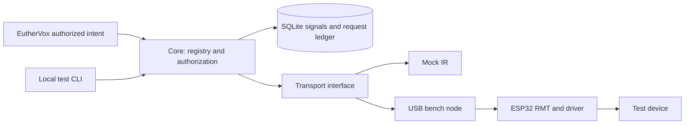

# Architecture

## Boundaries

- **Core**: TOML registry, credential-to-principal mapping, scopes and device
  allowlists, signal validation, durable request ledger, history and learning.
- **Node**: ESP32 RMT RX/TX, local NVS bench slot, physical enable, bounded serial
  input, watchdog, boot identity and fail-closed startup.
- **Transports**: `transmit(node, signal, request_id)` returns a completion fact.
  Mock and USB implementations share the core path. Future GPIO, UART and RS485
  plugins require their own bounded payload schemas; IR types do not enter the
  public execute request.
- **Integrations**: exact intent aliases produce registered operations. Core
  authorization runs again at execution. Adapter output is not authorization.

The original Core CLI path remains available. The deployed EutherVox gateway now
provides its own user-owned command registry and durable ledger for the same
node, through authenticated HTTPS; see docs/EUTHERVOX.md.

## Execution semantics

The core serializes mutations. It commits `accepted` before transmission. A crash
between reservation and completion leaves `accepted`: delivery is uncertain and
reusing the ID never sends again. Timeout becomes `unknown`; no automatic retry.
Duplicate IDs with a different principal/payload fail. The ledger is persistent
and intentionally not automatically purged. Database backup/retention must
preserve tombstones. IR emission cannot provide exactly-once appliance effects.

A maximum of one command per node per 500 ms and 250 ms waveform duration limits
output. A physical supply switch can cut emission immediately; software disable
stops subsequent requests, not an already queued RMT frame. The USB adapter arms
only for a command and attempts to disarm afterward. Firmware always boots disarmed.

## Security and recovery

Development HTTP is loopback only. Every endpoint requires a >=32-character
external token; production tokens should be 32 random bytes or stronger. Separate
operator and Vox credentials, scopes and device lists are required. No CORS,
public listener, shell execution, arbitrary raw execute, cloud or stored secrets.
Local root/account access remains trusted. Serial access is a physical/local
administrator boundary, not a remotely authenticated API. Keep the port private.

Before LAN deployment: provision node identity and per-node credentials locally;
use authenticated TLS (certificate pinning or private CA), bind only a private
interface, enforce firewall policy and application scopes. Discovery is never a
trust grant. Do not forward node ports. The pinned HTTPS transport implements this boundary.

Firmware update strategy: initial recovery via physical USB with LED power off;
no OTA endpoint. Before enabling OTA, implement signed images, protected trusted
keys, dual OTA slots, boot self-test and rollback via ESP-IDF, with target-specific
secure-boot/flash-encryption provisioning reviewed before irreversible eFuse
changes. No eFuses are burned by this project. A watchdog reset returns to disabled.
NVS errors fail closed rather than automatically erasing settings.

Only audio/display/test device categories are accepted. Do not register hazardous
appliances, locks or safety-critical equipment. Categories are an administrator
policy guard, not a detector of what hardware an IR signal actually controls.

## Remaining work

General identity enrollment, a standalone EutherID audience/action contract,
EutherNet collector extension, RC5/RC6 toggle handling, configuration migrations,
health heartbeats and independent device-state feedback. Add these after the
initial verified physical capture/replay gate.

## Native LAN node increment

The node now has pinned HTTPS control using a node-specific bearer credential.
Registered Logitech and explicitly learned audio/TV commands are accepted; a
bounded enable window and epoch-scoped duplicate ledger guard execution. See `docs/LAN_CONTROL.md`.
USB and LAN serialize RMT access through one mutex. Core still performs its
principal/device authorization and durable request reservation before dispatch.

## Implemented EutherVox adapter

The existing authenticated WebSocket gateway now owns IR labels, voice aliases
and a durable execution ledger. ESP32 HTTPS provides bounded capture, named NVS
registration and replay. EutherBeam remains a phone-side Android library using
paired local targets. See [current integration](docs/EUTHERVOX.md).
