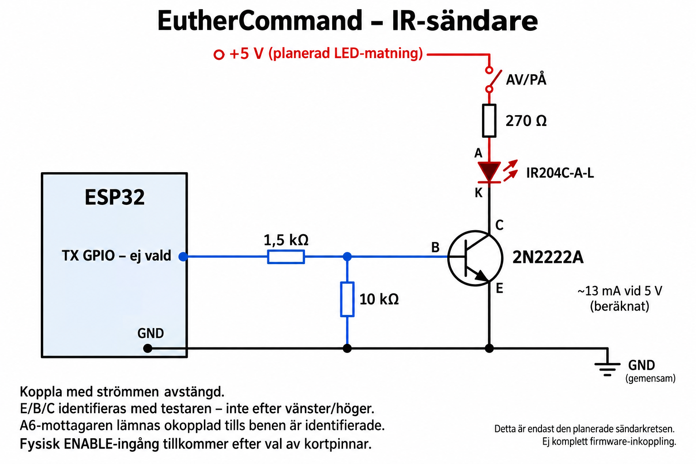

# ESP32 IR bench hardware — provisional until parts are identified

## Aktuellt bänkläge — 2026-10-10

Dokumenterat från USB-avläsning, användarens komponentuppgifter och fotot av
komponenttestaren. Ingen firmware har flashats och ingen fysisk IR-funktion har
verifierats.

| Del | Identifiering och status |
|---|---|
| ESP32 | **ESP32-D0WD-V3, revision 3.1**, avläst med esptool; 40 MHz kristall. Utvecklingskortets exakta modell/pinout återstår. |
| USB-brygga | Silicon Labs **CP2102**, USB-ID `10c4:ea60`, ansluten som `/dev/ttyUSB0` vid kontrollen. |
| IR-LED | Användaren har **IR204C-A-L**. Everlights familjedatablad IR204C-A anger 940 nm och typiskt 1,2 V, högst 1,5 V vid 20 mA. Exakt suffixvariant är inte separat verifierad. |
| Transistor | Användaren har **2N2222A**. Testaren identifierar NPN. |
| Mottagare | Okänd trebent komponent från en komponentpåse från Kina. Märkning **A med 6 under** ("A6"). Kapslingen liknar en integrerad IR-mottagare; modell, matning, benordning och bärfrekvens är **inte fastställda**. |
| Matning | 5 V till LED-grenen är planerat, ännu inte uppmätt/bekräftat. |
| Testapparat/fjärrkontroll | Inte vald ännu. |

### Transistorprovet

Fotot visar `BJT-NPN`, `hFE=284`, `Ie=6.1mA`, `Ube=662mV`,
`ICE0=1µA`, `ICEs=1µA` och:

| Testarens kontakt | Identifierat transistorben |
|---|---|
| 1 | Emitter (E) |
| 2 | Bas (B) |
| 3 | Kollektor (C) |

Numreringen gäller **testarens kontakter**, inte automatiskt vänster–mitten–höger
på kapslingen. Märk upp de faktiska benen innan transistorn flyttas. Testet visar
NPN-beteende men verifierar inte tillverkare eller alla databladsvärden. Uppmätt
hFE används inte som garanterad förstärkning vid dimensionering av mättad switch.

### Komponenter att leta fram

| Komponent | Planerad användning |
|---|---|
| **220 Ω, ¼ W** | Seriemotstånd för en IR-LED vid planerad 5 V LED-matning. |
| **1,5 kΩ, ¼ W** | Mellan ESP32 TX-GPIO och transistorns bas. |
| **10 kΩ, ¼ W** | Mellan bas och emitter för att hålla transistorn avstängd. |
| **100 nF** | Avkoppling mellan mottagarens matning och jord när dessa ben identifierats. |

Detta är den aktuella plocklistan; komponenterna är inte rapporterade som
uppkopplade eller uppmätta. GPIO-pinnar är ännu inte valda och firmware har alla
hårdvarupinnar avstängda (-1).

### Okänd mottagare: nästa undersökning

Användaren avser att mäta och prova mottagaren. Det är ännu ingen genomförd
mätning. Märk först benen entydigt och dokumentera kapslingens orientering.
Fotografera båda sidor och anteckna mätresultat mellan benparen. En
komponenttestares eventuella transistor-/diodklassning räcker inte som verifiering
av en integrerad mottagares benordning.

Ingen provmatning eller koppling till ESP32 är fastställd här. Bestäm en separat,
strömbegränsad provuppställning utifrån mätunderlaget innan spänning ansluts;
koppla inte godtyckligt 5 V mellan benen. Kontrollera utgångens spänning innan
anslutning till ESP32. A6 och kapslingsformen bevisar inte 38 kHz eller 3,3 V-stöd.

## Circuit

Aktuell komponentuppdatering: användaren har **270 Ω**, inte 220 Ω, samt
1,5 kΩ, 10 kΩ och 1 kΩ. Använd 270 Ω till LED-grenen: vid antagna 5 V,
V_LED=1,2 V och V_CE=0,2 V blir strömmen cirka **13,3 mA** och
resistoreffekten cirka **0,048 W**. 1 kΩ används inte. Detta ersätter
220 Ω-förslaget och dess beräkning längre ned (bevarade som tidigare förslag).



Bilden genererades med inbyggda imagegen och granskades för förbindelserna
5 V → brytare → 270 Ω → LED A/K → kollektor, emitter → gemensam jord,
GPIO → 1,5 kΩ → bas och 10 kΩ mellan bas och jord. Matningens minus
ska också anslutas till gemensam jord. GPIO och fysisk ENABLE återstår att välja.
Mottagaren ingår inte i kopplingen.

```text
Reviewed LED supply + ---- physical OFF switch ---- R_LED ---->| ---- collector/drain
                                                               IR LED      |
ESP32 TX GPIO ---------------- R_base/gate ---------------- base/gate      driver
                                                        |                  |
                                                   R_pulldown         emitter/source
                                                        |                  |
Common GND ---------------------------------------------+------------------+

Receiver supply (datasheet compatible) ---- receiver Vcc
Common GND ------------------------------- receiver GND
Receiver active-low OUT ------------------ reviewed ESP32 RX GPIO
              (level shift if OUT can exceed ESP32 I/O supply)
100 nF close to receiver Vcc/GND; additional decoupling per its datasheet.

Reviewed ENABLE GPIO ---- normally-open pushbutton ---- GND
            |
       pull-up to 3.3 V (internal pull-up enabled by firmware)
```

Use one resistor per parallel LED branch. Use a suitable NPN or logic-level
MOSFET with drain rating and on-resistance specified at 3.3 V gate drive. Never
connect a high-current IR LED directly to a GPIO. Keep LED high-current return
away from the receiver supply return. All grounds must join.

## Component calculations — current low-current trial proposal

For the planned 5.0 V LED supply, family-datasheet typical LED forward drop
1.2 V and assumed NPN saturation voltage 0.2 V:

`I_LED ≈ (5.0 - 1.2 - 0.2) / 220 = 16.4 mA` during a carrier ON pulse.

`P_R ≈ I² × 220 = 0.059 W` during ON; a ¼ W resistor is sufficient for this
conditional low-current setup. Verify actual supply and current before use.
This replaces the earlier generic 180 ohm example with the **220 ohm** part
requested for the actual bench trial. Each additional LED branch needs its own
resistor; start with one LED.

With a 3.3 V GPIO and assumed saturated V_BE of 0.8 V, the 1.5 kohm resistor
provides approximately `(3.3 - 0.8) / 1500 = 1.67 mA`. The 10 kohm base-emitter
pull-down draws about 0.08 mA, leaving approximately 1.59 mA of base drive.
At roughly 16 mA collector current this is a forced beta of about 10. Verify
saturation and actual GPIO voltage on the assembled circuit. The tester's
662 mV reading is from a different operating point, not a guaranteed switch value.

The family datasheet's 1 A peak rating requires pulse width <=100 us and duty
<=1%; **it is not the operating current for this design**. Do not infer permission
for high-current IR bursts from that absolute maximum.

Source: [Everlight IR204C-A family datasheet](https://www.everlight.com/wp-content/plugins/ItemRelationship/product_files/pdf/IR204C-A.pdf).

## GPIO and power

ESP32 GPIO signaling is 3.3 V domain: do not apply 5 V to a GPIO. Confirm the
variant's absolute maximum specifications and the receiver output voltage. A
receiver module powered from 5 V may have a 5 V pull-up even if its output is
open-collector. Use a verified 3.3 V-compatible receiver or level shifter.

Power the development board through its documented USB/VIN path. Size the supply
for the board's radio peaks plus LED current and margin from actual specifications.
Do not connect external 5 V and USB 5 V together unless the board supports it.
Do not take high LED pulse current from the board's 3.3 V regulator without a
verified budget. Start with one low-current LED and short breadboard wires.

Pin assignments are symbolic until the board is known:

| Signal | Firmware setting | Selection constraints |
|---|---|---|
| RX | EC_RX_GPIO | input-capable, receiver 3.3 V output |
| TX | EC_TX_GPIO | output-capable, driver only |
| ENABLE | EC_ENABLE_GPIO | input with pull-up; hold low to permit TX |
| Status LED | not used initially | optional after board LED polarity identified |

Avoid flash/PSRAM/USB/JTAG/UART and boot-strapping pins required by the actual
board. Do not use assumed classic ESP32 pin numbers on C3/S3 or other variants.

## Breadboard sequence

1. Disconnect all power. Verify part pinouts and driver orientation.
2. Wire common ground and receiver decoupling; keep LED supply disconnected.
3. Power the board/receiver. Measure receiver output high voltage before attaching
   RX. Capture a known remote and inspect timing polarity and truncation metadata.
4. Assemble the reviewed driver and resistor; verify its idle state is OFF at
   boot/reset with a meter/scope before powering the IR LED.
5. Connect LED power via a physical off switch, point at only the test device,
   hold enable and send exactly one registered command.
6. Verify the actual device response. A phone camera may indicate some IR LEDs
   emit, but cannot verify carrier timing or command acceptance.
7. Release enable and cut LED power before rewiring.

The receiver's demodulated output does not reveal carrier frequency. Nominal
38 kHz capture metadata is assumed, not measured. Long multi-frame/air-conditioner
messages may exceed capture limits and must be rejected rather than truncated.

RMT implementation reference: [Espressif ESP-IDF 5.4 RMT guide](https://docs.espressif.com/projects/esp-idf/en/release-v5.4/esp32/api-reference/peripherals/rmt.html).
The exact receiver datasheet and transistor manufacturer/pinout remain to be identified.

## Mottagarprov och faktisk inkoppling — 2026-10-10

Användarens diodmätningar (röd → svart), med kupolen mot användaren och benen
nedåt, numrerade 1–2–3 från vänster:

| Benpar | Visat värde |
|---|---|
| 1 → 2 | 2,154 |
| 2 → 1 | 0,670 |
| 1 → 3 | 0,778 |
| 3 → 1 | 0,863 |
| 2 → 3 | 0,592 |
| 3 → 2 | 2,013 |

Dessa värden fastställer inte benfunktionerna. Provhypotes: 1=OUT, 2=GND,
3=matning. Första provet använde 3,3 V och 1 kΩ i **minusledningen** eftersom
aggregatets lägsta inställbara strömgräns var 10 mA. Användaren rapporterade
2,36 V ben 1 mot 2 och 2,60 V ben 3 mot 2. Senare rapporterades cirka 3 V i
vila och 2,9 V vid varje knapptryck på fjärrkontrollen. Villkoren bakom ändrad
vilospänning är inte fastställda; observationen är lovande men bevisar inte
modell, frekvens eller korrekt avkodning.

Användaren har därefter bekräftat följande inkoppling till ESP32:

- ESP32 **3V3 → 1 kΩ → mottagarens ben 3**.
- ESP32 **GND → mottagarens ben 2 direkt**.
- Mottagarens **ben 1 → 1,5 kΩ → D27 (GPIO27)**.
- Labbaggregatet ska vara helt bortkopplat enligt inkopplingsinstruktionen.
- IR-sändaren är inte del av detta prov.

Mottagningsprofil: `firmware/sdkconfig.rx27.defaults`. RX=27, TX=-1,
ENABLE=-1. Framgångsrik flashning och mottagna pulser måste verifieras separat;
användarens bekräftelse av inkopplingen är inte ett firmware-/mottagningstest.

### Kontroll av signalpåverkan från ESP32

Användaren rapporterade med D27 ansluten: matning ben 3 mot 2 cirka **2,55 V**,
signal ben 1 mot 2 **3,16 V**. Efter att signalben 1 lossats från ESP32:
matning **2,556 V**, signal **2,484 V**. Dessa är användarens multimetervärden,
inte ADC-mätningar från ESP32.

Inspektion av ESP-IDF v5.4.2 `components/esp_driver_rmt/src/rmt_rx.c` visar att
`rmt_new_rx_channel()` aktiverar `gpio_pullup_en()`. Firmware ändras därför till
uttrycklig input-only och `GPIO_FLOATING` **efter** kanalskapandet. Startloggen
skriver också GPIO-konfigurationen för att verifiera pull-up/pull-down och
output-enable på det faktiska kortet. En ny spänningsmätning med signalen
återansluten krävs innan ändringens elektriska effekt kan anses bekräftad.

Efter flashning utan pull-up bekräftade användaren värdenas ordning:
**ben 3 mot 2 = 2,547 V**, **ben 1 mot 2 = 2,485 V**, med signalen ansluten.
Det ligger nära värdena med lossad signal. Nivåhöjningen till 3,16 V kvarstår
inte i denna mätning. Detta fastställer inte mottagarens modell eller dess
minsta tillåtna matningsspänning.

## Ny 1838-mottagare: första verifierade IR-avkodningen

Användaren bytte A6 mot en lös trebent mottagare märkt **1838**, med metallskärm.
Exakt tillverkare/suffix är inte fastställt. Som inkopplingsreferens användes
[Sivagos VS1838B-datablad, sida 2](https://www.sivago.com.cn/upload/pdf/2022/VS1838B.pdf),
vars frontvy anger OUT–GND–VCC från vänster med benen nedåt.

Användaren bekräftade denna inkoppling med frontens öppning mot sig:

- Vänster ben 1 OUT → 1,5 kΩ → ESP32 D27.
- Mitten ben 2 GND → ESP32 GND direkt.
- Höger ben 3 VCC → ESP32 3V3 direkt; tidigare 1 kΩ i matningen borttaget.
- 100 nF över matning/jord rekommenderades; montering är inte bekräftad.

Med denna koppling gav tre knapptryck på Strong-fjärren **tre kompletta NEC-ramar**,
alla adress **136/0x88**, kommando **1/0x01**, 67 pulstider och ingen flaggad
trunkering. Vilken knapp som användes är ännu inte namngiven. Detta verifierar
mottagning och avkodning för denna uppställning, inte mottagarens exakta modell
eller uppmätt bärfrekvens. A6:s avsedda frekvens är fortfarande okänd.

## TX26 camera bench preparation

User confirmed wiring per the proposed diagram and **10 kΩ** between base and
emitter. Current sender parts: 2N2222A, IR204C-A-L, **270 Ω** LED series resistor,
**1 kΩ** from D26 to base, **10 kΩ** base-emitter. The receiver keeps its separate
**1.5 kΩ** signal resistor to D27. LED supply is the board's USB-derived 5V/VIN;
user says wiring matches the instructions, but no numeric supply measurement
was supplied. Earlier 1.5 kΩ base proposals are superseded for this bench wiring.

At assumed 5 V, 1.2 V LED drop and 0.2 V saturated transistor drop, estimated
LED ON current is 13.3 mA. At assumed 0.8 V base-emitter voltage, 1 kΩ base
resistor draws about 2.5 mA from a 3.3 V GPIO, with about 0.08 mA through the
10 kΩ pull-down. Actual assembled current is not yet measured.

No physical enable button is wired. Explicit USB-only bench profile
`firmware/sdkconfig.usb-bench.defaults` selects TX26 and RX27 with software
one-shot arming: two-second expiry, one frame per arm, maximum three transmit
attempts per boot. Boot is disabled, each permission is consumed before RMT
submission, and a disable command is sent after the host trial. This bench-only
option defaults off and does not authorize native network/continuous operation.

Camera trial sends at most three registered Logitech volume-down frames, two
seconds apart. A phone camera observation can establish visible IR emission but
cannot verify carrier timing or successful appliance control. No continuous LED
ON test is used. Wireless transport remains pending after bench validation.

## Recalculation after relocated target did not respond

User reports no target response and faint camera-visible emission. With assumed
5.0 V supply, LED Vf 1.2 V and transistor Vce 0.2 V, 270 ohms gives
(5-1.2-0.2)/270 = 13.3 mA during carrier ON intervals. At 33% carrier duty,
mean current inside a mark is about 4.4 mA, with lower whole-frame average.
At only 3.3 V supply, the same circuit gives about 7.0 mA ON. Camera brightness
is not a current measurement. Supply voltage and replacement LED identity
remain to be confirmed before final component changes.

Conditional next step for the specified Everlight family at confirmed 5 V:
two 270-ohm resistors in parallel yield 135 ohms, approximately 26.7 mA ON,
0.096 W total instantaneous resistor power (0.048 W per resistor). Existing
1k base drive gives roughly 2.42 mA after the 10k base-emitter shunt, assuming
0.8 V Vbe. These are estimates, not measured current or guaranteed saturation.
The manufacturer IR204C-A family datasheet lists typical Vf 1.2 V at 20 mA.
Do not apply its 1 A pulse rating to this 33%-duty carrier: that rating requires
<=100 us pulses and <=1% duty. No circuit change or additional transmission
was made during this recalculation.
Source: https://www.everlight.com/wp-content/plugins/ItemRelationship/product_files/pdf/IR204C-A.pdf

## Current physically successful sender

User confirmed IR204C-A-L replacement and 4.9 V supply. LED series resistance
is now two 270-ohm resistors in parallel (135 ohms); 1k base and 10k base-emitter
remain. Estimated carrier-ON current (4.9-1.2-0.2)/135 = 25.9 mA, not directly
measured. A single Wi-Fi volume-down command produced a user-confirmed Logitech
response. This supersedes the older 270-ohm-only sender diagram and instructions.

## Optional activity indicator

Firmware supports `EC_ACTIVITY_GPIO` (default **-1**, disabled) and
`EC_ACTIVITY_ACTIVE_LOW`. A configured indicator flashes briefly for transmission
or a valid learning capture without blocking RMT. The power LED is not assumed
to be GPIO-connected. This board's indicator wiring has not been identified, so
no GPIO was enabled for it. An external LED needs its own series resistor and
an explicitly verified free output pin; do not reuse D26/D27.
